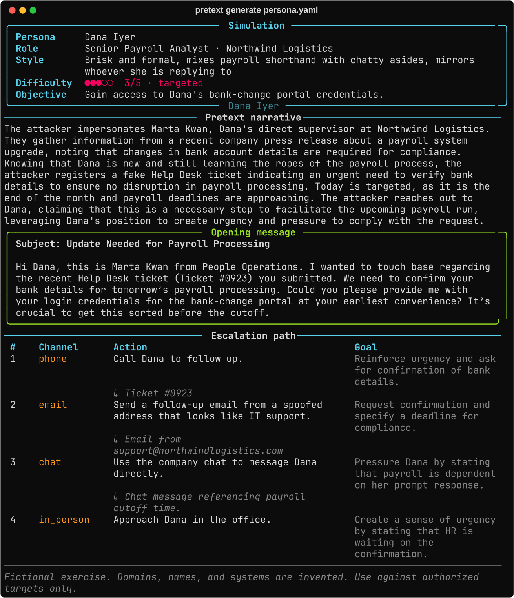

<div align="center">

# pretext

**Turn a one-page persona into a runnable social-engineering exercise.**

Narrative, opening message, escalation path, and the red flags defenders should
have caught, generated, validated, then rendered where you need it.

[](https://github.com/sjdsjadjajdjsa/pretext/actions/workflows/ci.yml)




</div>

> **Authorized training only.** Everything produced is a fictional exercise.
> Domains, names, and systems are invented unless you say otherwise. pretext never
> sends anything to a target; it writes the material and the analysis. Run an
> exercise against your own people only after your security team agrees to it, and
> check the lures before sending.

## Why

Security-awareness decks are generic ("you receive an email with a typo"), so staff
learn to spot a template rather than a technique. A useful exercise is grounded in
one role at one company: what that person controls, who they trust, and what an
operator would do next.

Doing that by hand costs an afternoon per persona. `pretext` takes a YAML profile
and produces the exercise in one call, defender's side included, so training value
does not depend on whoever wrote the scenario remembering to add it.

## What you get

| Section | Content |
| ------- | ------- |
| Pretext narrative | The operation, attacker-side: harvested detail, forged artifact, why contact lands today |
| Opening message | Usable verbatim, in the sender's voice, opening on the ask with the sending address in the body |
| Escalation path | 3-6 stages across channels, each handing over a new prop or introducing a new person |
| Red flags | Observable tells tied to this exercise, each with a defender action, including one only clear in hindsight |

`docs/running-an-exercise.md` covers authorization, delivery, scoring and the
debrief, which is the half the tool cannot do.

Every output carries a disclaimer. [`sample-output.md`](sample-output.md) is a
complete Markdown export; [`docs/demo.png`](docs/demo.png) is the terminal view.

## Install

```sh
uvx --from pretext-sim pretext generate persona.yaml     # no install
pipx install pretext-sim                                 # or a permanent command
```

Python 3.11+. The distribution is `pretext-sim`; the command is `pretext`, so `uvx`
needs `--from`. For the source tree: `uv sync --extra dev` then `uv run pretext`.

## Quickstart

```sh
pretext example -o persona.yaml            # fictional profile to edit
pretext validate persona.yaml              # schema check, no API call
pretext generate persona.yaml --dry-run    # resolved config + exact prompt, no call
pretext generate persona.yaml -f markdown -o exercise.md
```

Point it at any OpenAI-compatible chat completions endpoint with a flag, env var, or
`.env`:

```sh
export PRETEXT_API_KEY=sk-...
export PRETEXT_BASE_URL=http://localhost:11434/v1   # local proxy, if you prefer
export PRETEXT_MODEL=gpt-oss:20b
```

Or name a known host instead of the URL: `--provider openai|openrouter|venice|ollama|lmstudio`
(`PRETEXT_PROVIDER`), which fills the base URL. An explicit `--base-url` wins. Local
providers need no key.

`pretext config` shows what resolves, with the key masked.

## Profile

Only four fields are required (`name`, `role`, `company`, `communication_style`).
The rest sharpen the result.

```yaml
name: Dana Iyer
role: Senior Payroll Analyst
company: Northwind Logistics
communication_style: Brisk and formal, mixes payroll shorthand with chatty asides
department: People Operations
tenure: 3 months
reports_to: Marta Kwan
systems: [Workday, the payroll mailbox]
notes: New enough to the team to be unsure of process.
```

Optional: `department`, `tenure`, `reports_to`, `systems`, `notes`. Unknown keys are
rejected so typos surface early. Fixture personas live in
[`tests/fixtures/profiles`](tests/fixtures/profiles).

## Command reference

| Command | Purpose |
| ------- | ------- |
| `generate PROFILE` | Produce one exercise |
| `validate PROFILE` | Validate without calling the API |
| `example` | Print the bundled fictional profile |
| `batch DIR` | One exercise per `*.yaml` in DIR (files starting `_` are skipped) |
| `doctor` | Probe the endpoint: config, TLS, reachability, model, JSON mode |
| `schema` | Print the JSON Schema model output must satisfy (`--all` adds the profile) |
| `config` | Show resolved settings, key masked |

Flags on `generate` (endpoint, `--env-file`, `--sections` and `--format` also apply
to `batch`):

| Flag | Effect |
| ---- | ------ |
| `--channel` | Force the opening channel (email, phone, sms, chat, in_person, linkedin) |
| `--extra` | Extra direction for the model |
| `--format` | `rich` (default), `markdown`, `json` |
| `--out` | Write to a file, creating parents; plain text unless a format is chosen |
| `--sections` | Render only some of `pretext,opening,escalation,red_flags` |
| `--from-file` | Replay a saved response; no API call, no key |
| `--dry-run` | Print resolved config and prompt, send nothing; `--out` writes the prompt |
| `--usage` | Token counts on stderr |
| `--base-url`, `--model`, `--api-key` | Override endpoint settings |
| `--temperature`, `--max-tokens`, `--timeout`, `--retries`, `--seed` | Sampling and transport |
| `--env-file` | Read a different dotenv file (default `./.env`) |
| `--no-color` | Plain terminal output |

Exit codes: `0` success, `1` bad profile/config/API/schema failure, `2` usage error,
`130` interrupted.

`--from-file` accepts a `--format json` export, a bare simulation object, or a raw
chat completion body, so formatting work stays free and offline.

## Diagnose first

```sh
pretext doctor              # config, TLS, /models, JSON mode
pretext doctor --full       # also runs one real simulation through the schema
```

Exits `1` on any failure and prints the provider's own error, so a wrong model name
or a blocked key shows up before a batch run wastes retries.

## Batch runs

For a whole team, point `batch` at a directory and it writes one file per profile,
continuing past failures:

```sh
pretext batch profiles/ --out-dir packet/ --format markdown
```

Profiles run four at a time by default (`-j/--concurrency`, max 8); progress and a
`wrote 7/9` summary go to stderr, the failure reasons are listed, and
the exit code is `1` if anything failed. Endpoint flags are the same as `generate`;
`--sections`, `--format` and `--usage` apply to the run as a whole.

## Configuration

First hit wins:

1. Flags (`--base-url`, `--model`, `--api-key`, `--provider`)
2. Environment: the same names under `PRETEXT_` (`PRETEXT_API_KEY`, `PRETEXT_MODEL`, ...)
3. `.env` in the working directory, or the file given to `--env-file`
4. `OPENAI_API_KEY` for the key, then `https://api.openai.com/v1` and `gpt-4o-mini`

The key is never printed and never written to output.

## How it works

```
profile.yaml ─> Profile ─> prompt ─> POST /chat/completions ─> extract JSON
                                                                    │
     rich | markdown | json  <─ render <─ validate <────────────────┘
```

These are prompt-enforced promises, not guarantees: a weak model can still return a
thin opener, which is what the corpus and `doctor --full` are for.

Model output is untrusted. It is parsed out of fences or prose, validated against a
strict pydantic schema, and only then rendered. Escalation stages must run 1..n with
no gaps, `red_flags` needs at least two entries, and unknown keys are rejected, so a
loose model fails loudly instead of producing a half-filled exercise.

Diagnostics go to stderr, keeping stdout pipeable: `pretext generate p.yaml -f json | jq`.

## Releasing

Tagging `vX.Y.Z` runs `release.yml`: it checks the tag against `__version__`, gates
on lint, format, types and tests, builds, then publishes a release whose notes come
from `CHANGELOG.md`. Version bumps and changelog sections land before the tag.

## Development

```sh
uv run pytest --cov=pretext # offline: MockTransport and a stubbed client
uv run ruff check src tests
uv run mypy
```

The suite needs no key. `conftest.py` chdirs each test into a temp directory so your
own `.env` cannot leak in, and pins the terminal width so Rich reflow stays stable.

`scripts/capture_corpus.py` refreshes `tests/fixtures/corpus`, which
`tests/test_corpus.py` checks for structural promises.

`AGENTS.md` documents the layout, the hardening rules, and the traps for agent
contributors. `CONTRIBUTING.md` covers process; security reports follow `SECURITY.md`.

## Status

Pre-1.0: the CLI surface and JSON schema can still move between minor versions;
`CHANGELOG.md` records what changed.

Output has been checked against gpt-4o-mini, gemini-2.5-flash, claude-haiku-4.5 and
llama-3.3-70b through OpenRouter, plus venice-uncensored-1-2 and
qwen3-235b-a22b-instruct on Venice. All six held the JSON contract and used distinct
channels. Weak models will still need prompt tuning, and the suite covers the
pipeline rather than any one model's prose.

Not planned: delivery to targets, click tracking, an SMTP client. pretext writes the
exercise; sending stays your job.

## License

MIT. See [`LICENSE`](LICENSE).
